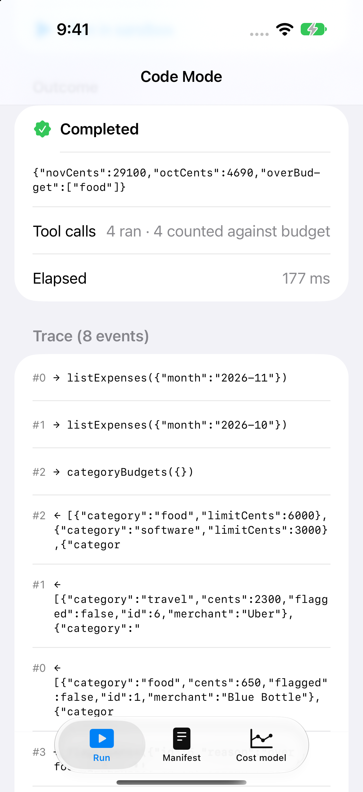
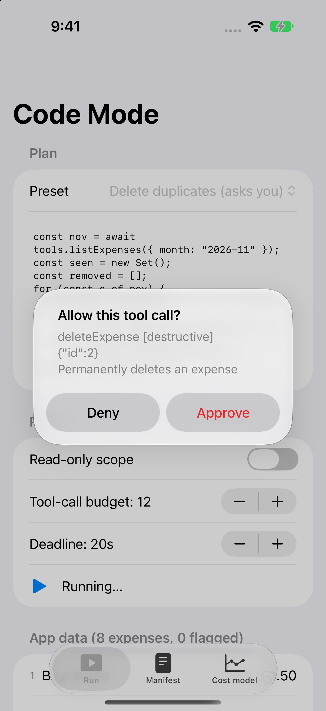
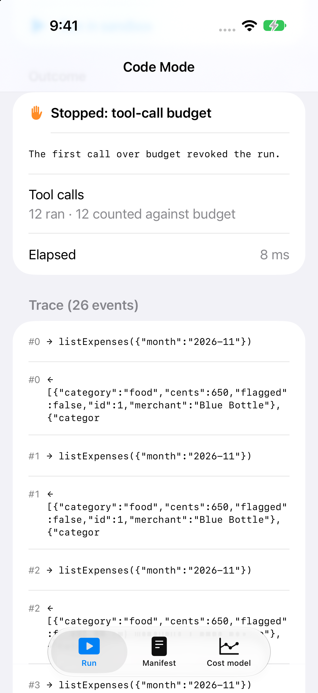
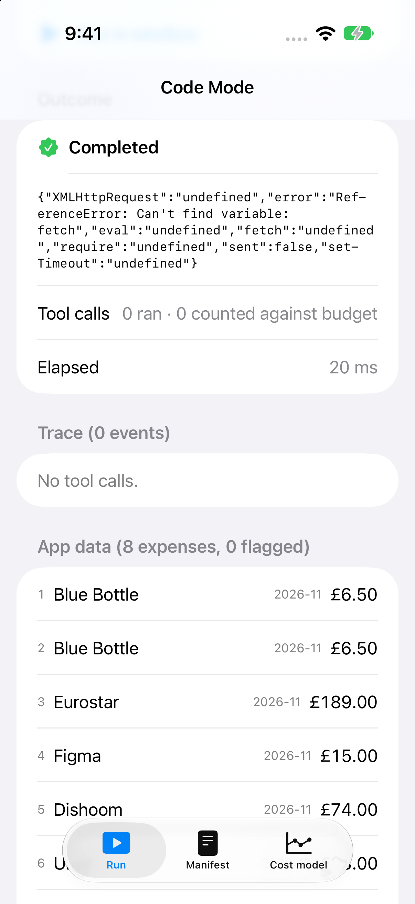
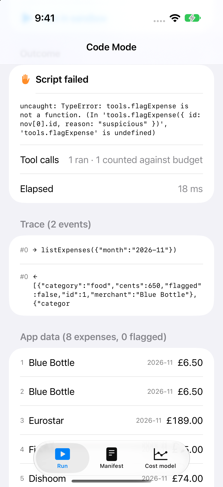
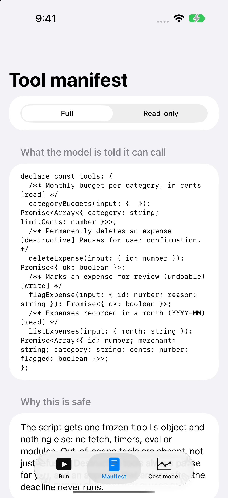
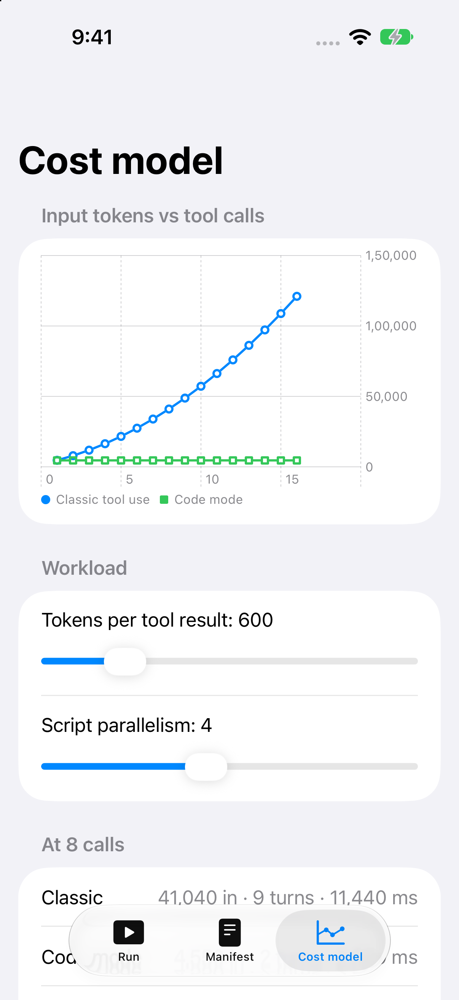

# Code Mode Demo

**Watch a model-written plan run in a JavaScriptCore sandbox, call typed Swift tools through one bridge, and get stopped at the edges.** This SwiftUI app is the companion to [CodeModeKit](https://github.com/rajatslakhina/code-mode-runtime-kit). It runs five canned plans of the kind Claude writes in code mode, against an in-memory expense store the app owns. One plan runs calls in parallel, one tries to delete and has to ask you, one tries to exfiltrate data, one loops forever, and one tries to write in a read-only run.

  
  
  

  
  
  
  

*Real screenshots from an iOS 27.2 Simulator (iPhone 18 Pro), taken from a build that resolved CodeModeKit 1.0.0 from GitHub. Left to right: monthly review, the confirmation dialog for a delete, the runaway loop stopped by the budget; then the exfiltration probe, the read-only run, the manifest and the cost model.*

## Why this matters

Code mode moves a hard problem onto the device: **the app is now executing code a model wrote.** The question an engineering lead has to answer isn't "can the model write JavaScript?" It's "what is the worst a plan can do, and how would we know?" Each preset in this app answers one part of that question on screen:

| Preset | What it shows |
|---|---|
| **Monthly review (parallel)** | Three tool calls in one `Promise.all`, totals computed in JavaScript, and `flagExpense` (a `write` tool) called for each category over budget. Only the summary returns. The trace shows each call numbered in program order. |
| **Delete duplicates (asks you)** | `deleteExpense` is `destructive`, so the bridge pauses and the app shows a dialog with the exact canonical arguments. Deny it and the script receives `denied: the user declined deleteExpense`. If the deadline passes while the dialog is open, the dialog is withdrawn and auto-denied. The library's tests cover the harder case, an Approve that arrives after the run ended: the tool still doesn't run. |
| **Exfiltration attempt** | `fetch`, `XMLHttpRequest`, `setTimeout`, `eval` and `require` are all `undefined`. The `fetch(...)` call throws a `ReferenceError`, and nothing leaves the device. |
| **Runaway loop** | `for (;;) await tools.listExpenses(...)` is stopped by the **first call over budget**, not by the deadline. |
| **Write in a read-only run** | In a read-only scope, `flagExpense` doesn't exist on `tools` at all, so the script fails with a `TypeError`. The bridge would refuse it anyway. |

The **Manifest** tab shows the TypeScript declarations the model is given, for the full scope and the read-only scope. The **Cost model** tab charts input tokens against tool-call count for classic tool use and code mode. It's a model with its assumptions stated in the footer, not a benchmark.

## How it's built

- **`Demo/DemoApp.swift`** holds the whole app. The app owns its domain (`ExpenseStore`, an actor) and its four tools (`ListExpenses`, `CategoryBudgets`, `FlagExpense`, `DeleteExpense`), each a `CodeModeTool` with a declared tier and schema. That's the app's reason to import CodeModeKit: the runtime, bridge, policy and sandbox come from the library, and the authority comes from the app.
- **`ConfirmationCenter`** (`@MainActor @Observable`) turns the library's `ConfirmationProvider` into a SwiftUI alert. When a run ends it denies anything still pending, so no continuation leaks.
- **The dependency** is a remote Swift package (`XCRemoteSwiftPackageReference` to `https://github.com/rajatslakhina/code-mode-runtime-kit.git`), pinned with `upToNextMajorVersion` from `1.0.0`, with `Package.resolved` committed. It doesn't use a local path or a branch.
- **Launch arguments** for repeatable screenshots: `-preset review|dedupe|exfil|runaway|scope`, `-autorun YES` (runs once on first appearance), and `-tab run|manifest|cost`.

## How to run it

1. `git clone https://github.com/rajatslakhina/code-mode-runtime-demo-app.git`
2. Open `Demo.xcodeproj` in Xcode 16 or later. Xcode resolves CodeModeKit from GitHub.
3. Select the **Demo** scheme and any iOS 17+ Simulator.
4. Build and Run, pick a preset, and tap **Run in sandbox**.

## Verification

Three different things were checked, and they're listed separately on purpose:

- **Resolves and builds from GitHub.** `xcodebuild -resolvePackageDependencies` resolved `CodeModeKit @ 1.0.0` from `https://github.com/rajatslakhina/code-mode-runtime-kit.git` (pinned in the committed `Package.resolved`). The app then built for `generic/platform=iOS Simulator` with Xcode 27.2: `BUILD SUCCEEDED`, 0 Swift warnings. The only build-log warning is Xcode's own "Metadata extraction skipped, no AppIntents.framework dependency found".
- **Ran on a Simulator.** That build was installed on a dedicated "CodeMode Demo iPhone 18 Pro" simulator (iOS 27.2) and launched headless with `xcrun simctl`, without Xcode's UI. There were seven launches: `-preset review|dedupe|exfil|runaway|scope -autorun YES`, `-tab manifest` and `-tab cost`. The app process was confirmed alive after each launch, and the seven screenshots above were captured from those launches. Nobody tapped anything. The dedupe screenshot shows the dialog waiting for an answer; Approve and Deny weren't exercised on the Simulator. The library's tests cover both decisions.
- **CI:** the [Actions workflow](https://github.com/rajatslakhina/code-mode-runtime-demo-app/actions/workflows/ci.yml) runs on a `macos-15` runner on pushes to `main`, on tags and on pull requests. It resolves the package from GitHub using only the committed `Package.resolved`, then builds for a generic iOS Simulator. The app target sets `SWIFT_TREAT_WARNINGS_AS_ERRORS = YES` in the project, scoped to the app so it doesn't collide with the warning suppression Xcode applies to remote packages. The workflow compiles the app; it doesn't launch it.

The library's own verification (72 tests on macOS, 57 on Linux, 29/29 mutants caught) is in the [library README](https://github.com/rajatslakhina/code-mode-runtime-kit#verification).

## License

MIT
